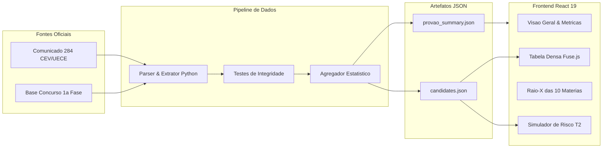

<br />
<div align="center">
  <a href="https://github.com/lucas-sva/provao">
    
  </a>

<h3 align="center">Mesmo Barco: Raio-X do Provão</h3>

  <p align="center">
    Inteligência analítica e auditoria dos resultados da Turma 1 para a Turma 2 (PC-CE)
    <br />
    <a href="https://lucas-sva.github.io/provao/"><strong>Acessar aplicação online</strong></a> · <a href="docs/AUDITORIA.md"><strong>Explore a auditoria de dados</strong></a>
    <br />
    <br />
  </p>
</div>

## Sobre o projeto

O **Mesmo Barco: Raio-X do Provão** é uma plataforma analítica auditável desenvolvida para processar, correlacionar e expor os resultados oficiais da Avaliação de Verificação de Aprendizagem do Curso de Formação Profissional (CFP) para o cargo de Oficial Investigador de Polícia da Polícia Civil do Estado do Ceará (**Comunicado Nº 284/2026-CEV/UECE**).

O objetivo central do projeto é fornecer aos alunos da Turma 2 (T2) uma visão estatística fidedigna sobre a régua de corte e a distribuição de notas da primeira turma, evidenciando pontos críticos de reprovação e o impacto direto do provão na classificação final para escolha de lotação.

### Principais constatações técnicas

- **Universo avaliado:** 689 alunos presentes no provão da T1.
- **Índice de reprovação:** 122 alunos (17,7%) não atingiram os perfis de aprovação na divulgação preliminar.
- **Régua de disciplina como principal fator de eliminação:** Apenas 21 candidatos (3,1%) foram reprovados por pontuação global (&lt; 80 pontos). Em contraste, **101 candidatos (14,7%) foram eliminados exclusivamente pelo corte de 7 pontos por matéria**, mesmo obtendo notas gerais elevadas (casos registrados de 93, 90 e 89 pontos).
- **Concentração em matéria única:** Dentre os reprovados no perfil de disciplina, **78,2% (79 candidatos)** foram desclassificados por apenas uma matéria.
- **Disciplinas críticas:** *Extração de Dados de Dispositivos Móveis* (40 reprovações, sendo causa única em 27 casos) e *Investigação de Homicídios e Feminicídios* (30 reprovações, causa única em 18 casos) concentraram mais da metade das eliminações.

A auditoria matemática completa e os critérios normativos da banca constam em [`docs/AUDITORIA.md`](docs/AUDITORIA.md).

## Arquitetura e design técnico

A solução opera como uma aplicação web estática (SPA) de alta performance, sem backend em tempo real, com processamento e agregação prévia dos dados oficiais em pipeline local e distribuição via CDN através do GitHub Pages.



Decisões de engenharia e especificações detalhadas: [`docs/adr/`](docs/adr/), [`docs/PLANO_IMPLEMENTACAO.md`](docs/PLANO_IMPLEMENTACAO.md).

### Estrutura da solução

```plaintext
data/                Documentos oficiais em PDF e base histórica de candidatos
docs/                Documentação técnica, auditoria e registros de decisão (ADRs)
docs/adr/            Architecture Decision Records (0001 a 0005)
public/data/         Artefatos JSON otimizados consumidos pela aplicação
scripts/             Scripts Python de extração, auditoria e enriquecimento
scripts/tests/       Suíte de testes de validação estatística e integridade
src/assets/          Logotipo geométrico vetorial e identidade visual
src/components/      Componentes de interface, cards métricos, gráficos e drawers
src/views/           Módulos principais (Visão Geral, Tabela, Disciplinas, Simulador)
src/lib/             Serviços de dados, motor de busca Fuse.js e cálculo de risco
src/types/           Definições de tipos TypeScript estritos
.github/workflows/   Pipeline CI/CD para deploy no GitHub Pages
```

### Built With

* [![React][react-shield]][react-url]
* [![TypeScript][typescript-shield]][typescript-url]
* [![Vite][vite-shield]][vite-url]
* [![Tailwind CSS][tailwind-shield]][tailwind-url]
* [![Python][python-shield]][python-url]
* [![GitHub Actions][gha-shield]][gha-url]

## Como começar

### Pré-requisitos

* **Node.js 18+** (ou runtime compatível)
* **Python 3.10+** (com `poppler-utils` para reprocessamento do PDF)

### Instalação

1. Clone o repositório:
   ```sh
   git clone https://github.com/lucas-sva/provao.git
   cd provao
   ```

2. Instale as dependências:
   ```sh
   npm install --no-bin-links
   ```

3. Execute a suíte de testes de integridade dos dados:
   ```sh
   python3 scripts/tests/test_data_integrity.py -v
   ```

4. Inicie o servidor de desenvolvimento:
   ```sh
   npm run dev
   ```

5. Para gerar a build de produção:
   ```sh
   npm run build
   ```

## Roadmap

- [x] Extração e auditoria dos 689 candidatos do Comunicado 284/2026-CEV/UECE
- [x] Cruzamento integral com a base histórica do concurso (1ª fase do Mesmo Barco)
- [x] Validação automatizada por testes unitários de integridade matemática
- [x] Módulo de Visão Geral com KPIs, ranking de matérias vilãs e reclassificação
- [x] Tabela densa com busca difusa (Fuse.js), filtros multicritério e exportação CSV
- [x] Raio-X individual das 10 disciplinas operacionais com distribuição de notas
- [x] Simulador de Risco T2 com parametrização em tempo real e testes de casos reais
- [x] Pipeline automatizado de deploy para GitHub Pages via GitHub Actions

## Contato

Lucas Silva - [LinkedIn](https://www.linkedin.com/in/-lucassva/) - lucas.sva@outlook.com

<p align="right">(<a href="#top">voltar ao topo</a>)</p>

[react-shield]: https://img.shields.io/badge/React%2019-20232A?style=for-the-badge&logo=react&logoColor=61DAFB
[typescript-shield]: https://img.shields.io/badge/TypeScript-007ACC?style=for-the-badge&logo=typescript&logoColor=white
[vite-shield]: https://img.shields.io/badge/Vite%208-646CFF?style=for-the-badge&logo=vite&logoColor=white
[tailwind-shield]: https://img.shields.io/badge/Tailwind%20CSS%20v4-38B2AC?style=for-the-badge&logo=tailwind-css&logoColor=white
[python-shield]: https://img.shields.io/badge/Python%203-3776AB?style=for-the-badge&logo=python&logoColor=white
[gha-shield]: https://img.shields.io/badge/GitHub%20Actions-2088FF?style=for-the-badge&logo=githubactions&logoColor=white

[react-url]: https://react.dev/
[typescript-url]: https://www.typescriptlang.org/
[vite-url]: https://vite.dev/
[tailwind-url]: https://tailwindcss.com/
[python-url]: https://www.python.org/
[gha-url]: https://github.com/features/actions
